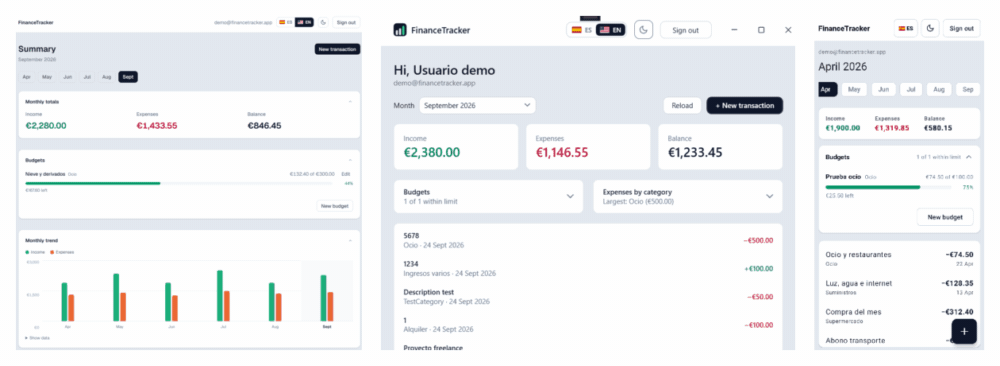
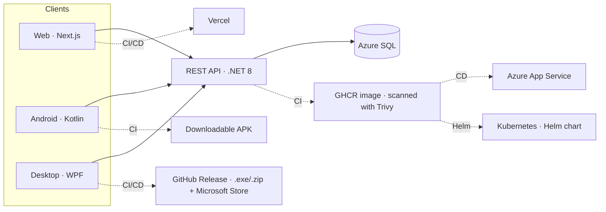
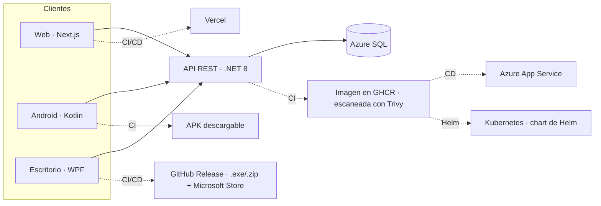

<b>🇬🇧 English</b> · 🇪🇸 Versión en español más abajo

### Hi, I'm Antonio Company 👋

.NET developer moving into DevOps and CI/CD. I come from building and maintaining business applications (C#, SQL Server), and I'm currently building my profile around Docker, pipeline automation and infrastructure as code.

 

## 🛠️ DevOps & Infrastructure
- Git / GitHub — version control
- GitHub Actions — CI/CD on Linux and Windows runners
- Azure DevOps — Repos (automatic mirror from GitHub), Boards, Pipelines and Wiki
- Docker and container registries (GHCR) — applied in personal projects
- Automated artifact publishing and versioned Releases
- Pipeline-gated deployments (Vercel) — shipping depends on the checks passing, not on the push
- DevSecOps — scanning of secrets (gitleaks), dependencies, the Docker image and the infrastructure (Trivy) before deploying, SAST with CodeQL and DAST with OWASP ZAP that blocks the deployment; least privilege in every pipeline
- Observability — Azure Monitor / Application Insights with OpenTelemetry, and email alerts on 5xx errors and 401/403 spikes
- Terraform — Azure infrastructure as code: imported existing resources, remote state in Azure Storage, security scanning of the configuration and an automatic `plan` on every PR via OIDC
- Azure Key Vault — production secrets read by the API through its managed identity, with RBAC and least privilege; the values never reach the Terraform state
- Jenkins — declarative pipelines (Jenkinsfile) with a controller and a Linux agent on Docker Compose, JUnit tests, artifacts, parameters and credentials
- Kubernetes and Helm — deploying the API to a cluster with my own chart: replicas and zero-downtime updates, startup/liveness/readiness probes, SQL Server as a StatefulSet with a persistent volume, and Ingress with Traefik

## 💻 Development
- C# / VB.NET · .NET Framework / .NET 8
- Entity Framework / EF Core / Windows Forms
- SQL Server
- HTML, CSS, JavaScript / TypeScript · Node.js, React, Tailwind CSS
- Java/Kotlin (Android Studio)

## 🚀 Featured projects

### FinanceTracker — one API, three clients

**⚡ Try it in one minute**

| 🌐 Web | 📱 Android | 🪟 Windows | 🔌 API |
|:---:|:---:|:---:|:---:|
| [Open the demo](https://financetracker-web-tau.vercel.app/login) | [Download APK](https://github.com/antonicr1986/financetracker-android/releases/latest/download/financetracker.apk) | [Microsoft Store](https://apps.microsoft.com/detail/9NT27R8DZ2DQ?hl=en-us) | [Swagger](https://financetracker-api-cpctbta0gddddge5.belgiumcentral-01.azurewebsites.net/swagger) |
| In the browser, nothing to install | Android 7.0 or later | Windows 10/11, one click | Documented endpoints |

Use the **demo account** button or `demo@financetracker.app` / `Demo1234!`. The API is on Azure's free tier: on weekdays during working hours it is kept awake, and all three apps wake the database as soon as the sign-in screen opens, so the wait happens while you read it.

A complete personal finance system: a REST API and three clients consuming it from different platforms. Writing several consumers is what turns an API into a contract: the same endpoints, the same error codes and the same business rules, reached from another language and another platform. The three clients share a corporate look, light/dark theme, Spanish/English and the same demo account, one click away.

- 🔗 [financetracker-web](https://github.com/antonicr1986/financetracker-web) — Web interface for FinanceTracker, built with Next.js 16, TypeScript and Tailwind CSS: sign-up and sign-in, transaction entry, filtering by type, category and text, a dashboard with charts built without external libraries, a light/dark theme and a fully bilingual interface (Spanish/English). One click gets you in with the demo account, no sign-up needed. Deployment is triggered by **the pipeline itself**, and only once secret scanning and the build are green. After every deployment, **OWASP ZAP** scans the published site (DAST). **[Open the live app](https://financetracker-web-tau.vercel.app/login)**

- 🔗 [financetracker-android](https://github.com/antonicr1986/financetracker-android) — Android client for FinanceTracker in Kotlin: the **second consumer of the same API**, which is what turns it into a contract — same endpoints, same error codes and same business rules from a different platform. Sign-up and sign-in, a month selector, totals, creating, editing and deleting transactions and the same look as the web app: a shared corporate palette, light/dark theme and Spanish/English from the top bar, switching without flashing. One tap gets you in with the demo account. The pipeline scans for secrets, runs the unit tests —and **fails if none ran**— and leaves a **downloadable APK** on every run. Tagging a version publishes a **Release with the signed APK**. **[Download the latest APK](https://github.com/antonicr1986/financetracker-android/releases/latest/download/financetracker.apk)**: one click, Android 7.0 or later.

- 🔗 [financetracker-desktop](https://github.com/antonicr1986/financetracker-desktop) — **Desktop client** for Windows in WPF and .NET 8, with **MVVM** (CommunityToolkit.Mvvm): C# on both ends of the system. Transactions, budgets, categories, registration and a saved session encrypted with Windows' **DPAPI**. Over 150 tests on the ViewModels and the HTTP client, with no windows and no network. The pipeline runs on a Windows runner and, when a version is tagged, publishes a **Release with the self-contained app** (a `.zip` and an `.exe`) with nothing to install, and builds the **MSIX** package for the Microsoft Store. **[Available on the Microsoft Store](https://apps.microsoft.com/detail/9NT27R8DZ2DQ?hl=en-us)**: one-click install, no SmartScreen warnings.

- 🔗 [FinanceTracker](https://github.com/antonicr1986/FinanceTracker) — REST API in .NET 8 with a layered architecture, JWT authentication and automated tests. Dockerised (API + SQL Server) and backed by a pipeline that builds, runs the tests and **publishes the image to GitHub Container Registry**, tagged by commit so any specific version can be deployed or rolled back. In production, **Azure App Service runs that very same image** —the one that passed the scan— against Azure SQL, deployed from the pipeline itself without rebuilding. It is only deployed if **every** check passes —tests, secrets, image and infrastructure—, and before deploying **OWASP ZAP** attacks every endpoint in a throwaway environment. The Azure infrastructure is described with **Terraform** and scanned with **Trivy** before every deployment: every pull request gets an automatic `plan`, signing in to Azure via **OIDC** —no passwords stored in GitHub— with a read-only identity. The connection string and the JWT key live in **Key Vault**, and the API reads them at startup through its **managed identity**: its configuration holds only references, not passwords. In production, **Application Insights** (OpenTelemetry) collects requests, errors and logs, and Azure Monitor emails me on 5xx errors or 401/403 spikes. The same image is also deployed to **Kubernetes** with my own **Helm chart**: 2 replicas with zero-downtime updates, startup, liveness and readiness probes, an *initContainer* that waits for the database, SQL Server as a StatefulSet with a persistent volume, and Ingress with Traefik; the pipeline validates the chart on every pull request. **[Browse the API in Swagger](https://financetracker-api-cpctbta0gddddge5.belgiumcentral-01.azurewebsites.net/swagger)** — it's on a free tier with serverless SQL, so the first request after a while idle takes a few seconds.

### Other projects

- 🔧 **Jenkins CI for .NET** *(private repos)* — Jenkins set up with **Docker Compose** the way a company would: a *controller* that only coordinates (0 executors) and a **Linux agent with the .NET 10 SDK** connected over WebSocket. A **declarative Jenkinsfile** versioned in Git restores, builds, runs the tests with **JUnit** results published and archives fingerprinted artifacts. When tests fail, the build goes **UNSTABLE** and nothing is published. It includes build parameters, credentials masked in the logs, cloning the private repo with a read-only token, SCM polling, `timeout` and build rotation. The infrastructure is in Git too: it is reproduced on another machine with a `docker compose up`.

- 🔗 [BlocDeNotas](https://github.com/antonicr1986/BlocDeNotas) — Desktop application in Windows Forms (.NET Framework 4.7.2). Pipeline on a Windows runner using MSBuild and NuGet, with **automatic Release publishing** when a version tag is pushed: it packages the executable, generates the changelog and stamps the version number into the binary itself.

> Beyond GitHub Actions and Azure DevOps, the same build, test and artifact cycle running on Jenkins with containerised agents.
>
> Four different delivery models, each where it fits: the API publishes a container image and is deployed to Azure App Service; the web client is published as a site, and only if the preceding checks pass; the two desktop apps publish a versioned executable ready to download; and the Android app leaves an APK on every run and a signed one on every version. The pipeline adapts to whatever has to be delivered.

## 🔒 Security across my repositories (DevSecOps)

> **Detecting and preventing are different layers, and both are needed.**

| Layer | Tool | When it acts |
|---|---|---|
| 🛑 Prevent secret leaks | **gitleaks** in a `pre-commit` hook | Before the commit exists |
| 🔍 Detect secret leaks | **gitleaks** in CI · GitHub *push protection* | On every push, in all my public repos |
| 🧠 Static code analysis (SAST) | **CodeQL** | On every push and pull request |
| 📦 Vulnerable dependencies | `dotnet list package --vulnerable` · `npm audit` · dependency graph + *dependency review* | On every pipeline and pull request |
| 🐳 Docker image | **Trivy** | Before pushing to GHCR |
| 📱 Android APK | **MobSF** | On every push and pull request (blocks on new high findings) |
| 🏗️ Infrastructure as code | **Trivy** (`trivy config`) | Before deploying |
| 🌐 Running application (DAST) | **OWASP ZAP**: active and authenticated in a throwaway environment · passive in production | Before deploying the API (blocks) and after every deployment |
| 🗝️ Production secrets | **Azure Key Vault** · managed identity | Always: the API reads them at startup |
| 🔐 Least privilege | read-only `GITHUB_TOKEN` · **OIDC** | In every workflow |
| 🔄 Staying up to date | **Dependabot** | One pull request a month |

### 🔑 Secrets

- **Custom rules.** They extend gitleaks' defaults, which catch keys from well-known providers but not a password inside a connection string — the shape a leak takes in a .NET project.
- **Audited history.** It surfaced real credentials from 2023 and 2024. They are revoked, and each is recorded in `.gitleaksignore` with what it was and what was done, because a pipeline that stays red stops being read.
- **CI detects, the hook prevents.** By the time the workflow fails, the commit is already published; the local `pre-commit` hook blocks it before it exists.
- **No secrets from the first commit.** The Telegram bot never had its token in the code: it reads it from an environment variable.

### 📦 Dependencies

- **Each ecosystem with its own tool**, transitive dependencies included: .NET and npm with theirs; on Android, since Gradle has no equivalent, the CI submits the dependency graph to GitHub and a review blocks pull requests that introduce a vulnerable one.
- **Trivy on the API image.** It also covers the base OS libraries, which no .NET tool sees. With a high or critical vulnerability that has a fix, the image is not published.
- **Dependabot, without the noise.** A single monthly pull request with minor and patch updates, for packages and workflow actions. Major versions are ignored on purpose: they can break the code, and that deserves a decision, not one more PR.

### 🚦 From pipeline to production

- **Nothing reaches production without passing every check.** The API deployment waits for the tests, the secret scan, the image scan and the infrastructure scan: if one fails, nothing is deployed.
- **The infrastructure is scanned too.** Trivy reviews the Terraform before every deployment and blocks high or critical findings. Exceptions are deliberate decisions (for instance, what the free tier does not allow) and are documented with their reason in `.trivyignore`.
- **DAST that blocks.** Before deploying, the pipeline starts a throwaway API and SQL Server, signs in and OWASP ZAP attacks every endpoint from the Swagger spec: if it finds anything new, nothing is deployed. Afterwards, ZAP passively reviews the published API and web app. Accepted risks are documented with their reason in `.zap/rules.tsv`, and reports are kept as artifacts rather than issues, because the repos are public.
- **Security headers** on the API and the web app (CSP, HSTS, anti-clickjacking, `nosniff`...), added from the ZAP reports.
- **Watching production.** Application Insights collects the API's requests, errors and logs, and Azure Monitor sends an email on 5xx errors or 401/403 spikes, the footprint of a brute-force attack. All defined in Terraform.
- **Rotatable credentials.** The SQL admin password is a Terraform *write-only* argument: rotating it means bumping a version number, and it never reaches the state.
- **Least privilege.** The `GITHUB_TOKEN` is read-only by default and each job asks only for what it needs. Azure is reached via OIDC, with no passwords stored in GitHub, and the API has its own managed identity, whose only permission is reading secrets from its Key Vault.
- **Bounded pipelines.** Only one production deployment at a time (`concurrency`) and a time limit per job, so a stuck one does not burn minutes for hours.

---

- 🔭 At WORK: .NET developer, with some work on Android and internal web apps.
- 🌱 Currently learning: GitOps with Argo CD and Jenkins Configuration as Code, applying them in personal projects.
- 🤔 Interested in going deeper into: application architecture, AI tooling, testing and best practices.
- 📫 Contact: [LinkedIn](https://www.linkedin.com/in/antoniocompany/?locale=en-US "Go to my profile") · [Interactive CV](https://antonio-cv-five.vercel.app/?lang=en "See my interactive CV").
- ⚡ Outside of code: I follow tech news and enjoy sport.

<b>🇪🇸 Español</b>

### Hola, soy Antonio Company 👋

Desarrollador .NET en transición a DevOps CI/CD. Vengo del desarrollo y mantenimiento de aplicaciones empresariales (C#, SQL Server) y ahora mismo estoy construyendo mi perfil en Docker, automatización de pipelines e infraestructura como código.

 

## 🛠️ DevOps & Infraestructura
- Git / GitHub — control de versiones
- GitHub Actions — CI/CD sobre runners Linux y Windows
- Azure DevOps — Repos (espejo automático desde GitHub), Boards, Pipelines y Documentación (wiki)
- Docker y registros de imágenes (GHCR) — aplicado en proyectos personales
- Publicación automatizada de artefactos y Releases versionadas
- Despliegue controlado desde el pipeline (Vercel) — la publicación depende de que los controles pasen, no del push
- DevSecOps — escaneo de secretos (gitleaks), de dependencias, de la imagen Docker y de la infraestructura (Trivy) antes de desplegar, SAST con CodeQL y DAST con OWASP ZAP que bloquea el despliegue; permisos mínimos en todos los pipelines
- Observabilidad — Azure Monitor / Application Insights con OpenTelemetry, y alertas por email ante errores 5xx y picos de 401/403
- Terraform — infraestructura de Azure como código: import de recursos existentes, estado remoto en Azure Storage, escaneo de seguridad de la configuración y `plan` automático en cada PR con OIDC
- Azure Key Vault — secretos de producción que la API lee con su identidad administrada, con RBAC y mínimo privilegio; los valores nunca llegan al estado de Terraform
- Jenkins — pipelines declarativos (Jenkinsfile) con controller y agente Linux en Docker Compose, tests JUnit, artefactos, parámetros y credenciales
- Kubernetes y Helm — despliegue de la API en un clúster con un chart propio: réplicas y actualizaciones sin corte, sondas startup/liveness/readiness, SQL Server en StatefulSet con volumen persistente e Ingress con Traefik

## 💻 Desarrollo
- C# / VB.NET · .NET Framework / .NET 8
- Entity Framework / EF Core / Windows Forms
- SQL Server
- HTML, CSS, JavaScript / TypeScript · Node.js, React, Tailwind CSS
- Java/Kotlin (desarrollo con Android Studio)

## 🚀 Proyectos destacados

### FinanceTracker — una API y tres clientes

**⚡ Pruébalo en 1 minuto**

| 🌐 Web | 📱 Android | 🪟 Windows | 🔌 API |
|:---:|:---:|:---:|:---:|
| [Abrir la demo](https://financetracker-web-tau.vercel.app/login) | [Descargar APK](https://github.com/antonicr1986/financetracker-android/releases/latest/download/financetracker.apk) | [Microsoft Store](https://apps.microsoft.com/detail/9NT27R8DZ2DQ?hl=es-es) | [Swagger](https://financetracker-api-cpctbta0gddddge5.belgiumcentral-01.azurewebsites.net/swagger) |
| En el navegador, sin instalar nada | Android 7.0 o superior | Windows 10/11, un clic | Endpoints documentados |

Entra con el botón de la **cuenta de demostración** o con `demo@financetracker.app` / `Demo1234!`. La API está en el plan gratuito de Azure: entre semana, en horario laboral, se mantiene despierta, y las tres apps despiertan la base de datos en cuanto se abre el login, así que la espera ocurre mientras lo lees.

Un sistema de finanzas personales completo: una API REST y tres clientes que la consumen desde plataformas distintas. Escribir varios consumidores es lo que convierte una API en un contrato: los mismos endpoints, los mismos códigos de error y las mismas reglas de negocio, alcanzados desde otro lenguaje y otra plataforma. Los tres clientes comparten estética corporativa, tema claro/oscuro, español/inglés y la misma cuenta de demostración, a un clic.

- 🔗 [financetracker-web](https://github.com/antonicr1986/financetracker-web) — Interfaz web de FinanceTracker en Next.js 16, TypeScript y Tailwind CSS: registro e inicio de sesión, alta de transacciones, filtros por tipo, categoría y texto, dashboard con gráficos sin librerías externas, tema claro/oscuro e interfaz completa en español e inglés. Se entra en un clic con la cuenta de demostración, sin registrarse. El despliegue lo lanza **el propio pipeline**, y solo después de que el escaneo de secretos y la compilación estén en verde. Tras cada despliegue, **OWASP ZAP** analiza la web publicada (DAST). **[Abrir la aplicación](https://financetracker-web-tau.vercel.app/login)**

- 🔗 [financetracker-android](https://github.com/antonicr1986/financetracker-android) — Cliente Android de FinanceTracker en Kotlin: el **segundo consumidor de la misma API**, que es lo que la convierte en un contrato — mismos endpoints, mismos códigos de error y mismas reglas de negocio desde otra plataforma. Registro e inicio de sesión, selector de meses, totales, alta, edición y borrado de movimientos, presupuestos mensuales con barra de progreso y la misma estética que la web: paleta corporativa común, tema claro/oscuro y español/inglés desde la barra superior, con cambio sin parpadeo. Se entra en un toque con la cuenta de demostración. El pipeline escanea secretos, ejecuta las pruebas unitarias —y **falla si no se ejecuta ninguna**— y deja el **APK descargable** en cada ejecución. Al etiquetar una versión, publica una **Release con el APK firmado**. **[Descargar el último APK](https://github.com/antonicr1986/financetracker-android/releases/latest/download/financetracker.apk)**: un clic, Android 7.0 o superior.

- 🔗 [financetracker-desktop](https://github.com/antonicr1986/financetracker-desktop) — **Cliente de escritorio** para Windows en WPF y .NET 8, con **MVVM** (CommunityToolkit.Mvvm): C# en los dos extremos del sistema. Movimientos, presupuestos, categorías, registro y la sesión guardada cifrada con **DPAPI** de Windows. Más de 150 pruebas sobre los ViewModels y el cliente HTTP, sin ventanas ni red. El pipeline corre en un runner de Windows y, al etiquetar una versión, publica una **Release con la aplicación autocontenida** (un `.zip` y un `.exe`), sin nada que instalar, y genera el paquete **MSIX** para la Microsoft Store. **[Disponible en Microsoft Store](https://apps.microsoft.com/detail/9NT27R8DZ2DQ?hl=es-es)**: se instala con un clic y sin avisos de SmartScreen.

- 🔗 [FinanceTracker](https://github.com/antonicr1986/FinanceTracker) — API REST en .NET 8 con arquitectura por capas, autenticación JWT y tests automatizados. Dockerizada (API + SQL Server) y con un pipeline que compila, ejecuta los tests y **publica la imagen en GitHub Container Registry**, etiquetada por commit para poder desplegar o revertir cualquier versión concreta. En producción, **Azure App Service ejecuta esa misma imagen** —la que ha pasado el escaneo— contra Azure SQL, desplegada desde el propio pipeline sin volver a compilar. Solo se despliega si pasan **todos** los controles —tests, secretos, imagen e infraestructura—, y antes de desplegar **OWASP ZAP** ataca todos sus endpoints en un entorno desechable. La infraestructura de Azure está descrita con **Terraform** y escaneada con **Trivy** antes de cada despliegue: cada pull request muestra un `plan` automático, con acceso a Azure por **OIDC** —sin contraseñas guardadas en GitHub— y una identidad de solo lectura. La cadena de conexión y la clave JWT viven en **Key Vault**, y la API las lee al arrancar con su **identidad administrada**: en su configuración solo hay referencias, no contraseñas. En producción, **Application Insights** (OpenTelemetry) recoge peticiones, errores y logs, y Azure Monitor avisa por email ante errores 5xx o picos de 401/403. La misma imagen también se despliega en **Kubernetes** con un **chart de Helm** propio: 2 réplicas con actualizaciones sin corte, sondas de arranque, vida y disponibilidad, un *initContainer* que espera a la base de datos, SQL Server en un StatefulSet con volumen persistente e Ingress con Traefik; el pipeline valida el chart en cada pull request. **[Ver la API en Swagger](https://financetracker-api-cpctbta0gddddge5.belgiumcentral-01.azurewebsites.net/swagger)** — plan gratuito con SQL serverless, así que la primera petición tras un rato de inactividad tarda unos segundos.

### Otros proyectos

- 🔧 **Jenkins CI para .NET** *(repos privados)* — Jenkins montado con **Docker Compose** como en una empresa: un *controller* que solo coordina (0 ejecutores) y un **agente Linux con el SDK de .NET 10** conectado por WebSocket. Un **Jenkinsfile declarativo** versionado en Git restaura, compila, ejecuta los tests con resultados **JUnit** publicados y archiva los artefactos con huella. Si fallan tests, el build queda **UNSTABLE** y no se publica nada. Incluye parámetros de compilación, credenciales enmascaradas en los logs, clonado del repo privado con un token de solo lectura, polling del SCM, `timeout` y rotación de builds. La infraestructura también está en Git: se reproduce en otro equipo con un `docker compose up`.

- 🔗 [BlocDeNotas](https://github.com/antonicr1986/BlocDeNotas) — Aplicación de escritorio en Windows Forms (.NET Framework 4.7.2). Pipeline sobre runner de Windows con MSBuild y NuGet, y **publicación automática de Releases** al etiquetar una versión: empaqueta el ejecutable, genera el changelog y sella el número de versión en el propio binario.

> Además de GitHub Actions y Azure DevOps, el mismo ciclo de build, test y artefactos montado sobre Jenkins con agentes en contenedores.
>
> Cuatro modelos de entrega distintos: uno publica una imagen de contenedor y despliega la API sobre Azure App Service; otro publica un ejecutable versionado listo para descargar; otro publica un sitio web, y solo si los controles previos pasan; y el último deja un APK instalable en cada ejecución. El pipeline se adapta a lo que hay que entregar.

## 🔒 Seguridad en mis repositorios (DevSecOps)

> **Detectar y prevenir son capas distintas, y hacen falta las dos.**

| Capa | Herramienta | Cuándo actúa |
|---|---|---|
| 🛑 Prevenir fugas de secretos | **gitleaks** en un hook `pre-commit` | Antes de que el commit exista |
| 🔍 Detectar fugas de secretos | **gitleaks** en CI · *push protection* de GitHub | En cada push, en todos mis repos públicos |
| 🧠 Análisis estático del código (SAST) | **CodeQL** | En cada push y pull request |
| 📦 Dependencias vulnerables | `dotnet list package --vulnerable` · `npm audit` · grafo de dependencias + *dependency review* | En cada pipeline y pull request |
| 🐳 Imagen Docker | **Trivy** | Antes de publicar en GHCR |
| 📱 APK de Android | **MobSF** | En cada push y pull request (bloquea con hallazgos altos nuevos) |
| 🏗️ Infraestructura como código | **Trivy** (`trivy config`) | Antes de desplegar |
| 🌐 Aplicación en marcha (DAST) | **OWASP ZAP**: activo y autenticado en un entorno desechable · pasivo en producción | Antes de desplegar la API (bloquea) y después de cada despliegue |
| 🗝️ Secretos en producción | **Azure Key Vault** · identidad administrada | Siempre: la API los lee al arrancar |
| 🔐 Mínimo privilegio | `GITHUB_TOKEN` de solo lectura · **OIDC** | En todos los workflows |
| 🔄 Mantenerse al día | **Dependabot** | Una pull request al mes |

### 🔑 Secretos

- **Reglas propias.** Extienden las de gitleaks: las de serie detectan claves de proveedores conocidos, pero no una contraseña dentro de una cadena de conexión, que es la forma que toma una fuga en un proyecto .NET.
- **Historial auditado.** Aparecieron credenciales reales de 2023 y 2024. Están revocadas y cada una queda registrada en `.gitleaksignore` con qué era y qué se hizo, porque un pipeline siempre en rojo deja de leerse.
- **El CI detecta, el hook previene.** Cuando el workflow falla, el commit ya está publicado; el `pre-commit` local lo bloquea antes de que llegue a existir.
- **Sin secretos desde el primer commit.** El bot de Telegram nunca tuvo el token en el código: lo lee de una variable de entorno.

### 📦 Dependencias

- **Cada ecosistema con su herramienta**, también para dependencias transitivas: .NET y npm con las suyas; en Android, como Gradle no trae un equivalente, el CI envía el grafo de dependencias a GitHub y una revisión bloquea las pull requests que introducen una vulnerable.
- **Trivy en la imagen de la API.** Revisa también las librerías del sistema operativo base, que ninguna herramienta de .NET ve. Con una vulnerabilidad alta o crítica que tenga parche, la imagen no se publica.
- **Dependabot, sin ruido.** Una única pull request mensual con las actualizaciones menores y de parche, de paquetes y de acciones. Las versiones mayores se ignoran a propósito: pueden romper el código, y eso merece una decisión, no una PR más.

### 🚦 Del pipeline a producción

- **Nada llega a producción sin pasar todos los controles.** El despliegue de la API espera a los tests, al escaneo de secretos, al de la imagen y al de la infraestructura: si uno falla, no se despliega.
- **La infraestructura también se escanea.** Trivy revisa el Terraform antes de cada despliegue y bloquea los hallazgos altos o críticos. Las excepciones son decisiones conscientes (por ejemplo, lo que el plan gratuito no permite) y quedan documentadas con su motivo en `.trivyignore`.
- **DAST que bloquea.** Antes de desplegar, el pipeline levanta la API y un SQL Server desechables, inicia sesión y OWASP ZAP ataca todos los endpoints a partir del Swagger: si encuentra algo nuevo, no se despliega. Después, ZAP revisa de forma pasiva la API y la web ya publicadas. Los riesgos aceptados están documentados con su motivo en `.zap/rules.tsv`, y los informes quedan como artefactos y no como issues, porque los repos son públicos.
- **Cabeceras de seguridad** en la API y la web (CSP, HSTS, anti-clickjacking, `nosniff`...), añadidas a partir de los informes de ZAP.
- **Vigilancia en producción.** Application Insights recoge peticiones, errores y logs de la API, y Azure Monitor avisa por email ante errores 5xx o picos de 401/403, la huella de un ataque de fuerza bruta. Todo definido en Terraform.
- **Credenciales que se rotan.** La contraseña del administrador SQL es un argumento *write-only* de Terraform: rotarla es subir un número de versión, sin que llegue nunca al estado.
- **Mínimo privilegio.** El `GITHUB_TOKEN` es de solo lectura por defecto y cada job pide solo lo que necesita. Azure se alcanza por OIDC, sin contraseñas guardadas en GitHub, y la API tiene su propia identidad administrada, cuyo único permiso es leer los secretos de su Key Vault.
- **Pipelines acotados.** Un solo despliegue a producción a la vez (`concurrency`) y un tiempo máximo por job, para que uno colgado no consuma minutos durante horas.

---

- 🔭 En EL TRABAJO: programador .NET, con incursiones en apps Android y web internas.
- 🌱 Aprendiendo ahora mismo: GitOps con Argo CD y Jenkins Configuration as Code, aplicándolo en proyectos personales.
- 🤔 Me interesa profundizar en: arquitectura de aplicaciones, herramientas IA, testing y buenas prácticas.
- 📫 Contacto: [LinkedIn](https://www.linkedin.com/in/antoniocompany/?locale=es-ES "Ir a mi perfil") · [CV web](https://antonio-cv-five.vercel.app/?lang=es "Ver mi CV").
- ⚡ Fuera del código: sigo la actualidad tecnológica y me gusta hacer deporte.

