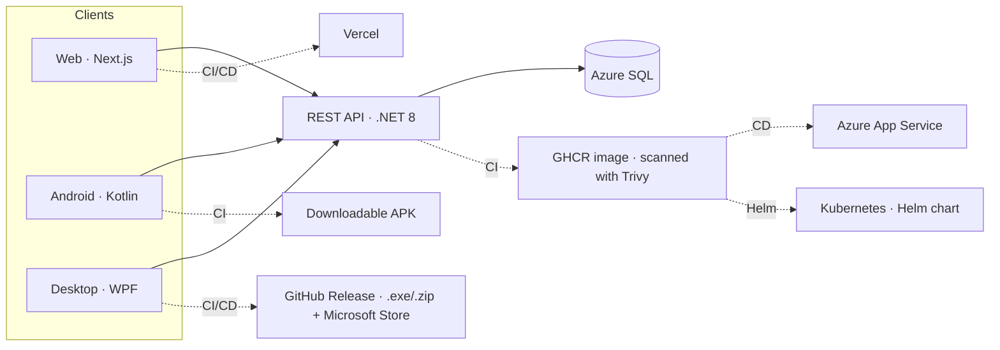

**English** · [Español](https://github.com/antonicr1986/antonicr1986/blob/main/README.es.md)

### Hi, I'm Antonio Company 👋

.NET developer moving into DevOps and CI/CD. I come from building and maintaining business applications (C#, SQL Server), and I'm currently building my profile around Docker, pipeline automation and infrastructure as code.

 

## 🛠️ DevOps & Infrastructure
- Git / GitHub — version control
- GitHub Actions — CI/CD on Linux and Windows runners
- Azure DevOps — Repos (automatic mirror from GitHub), Boards, Pipelines and Wiki
- Docker and container registries (GHCR) — applied in personal projects
- Automated artifact publishing and versioned Releases
- Pipeline-gated deployments (Vercel) — shipping depends on the checks passing, not on the push
- DevSecOps — scanning of secrets (gitleaks), dependencies, the Docker image and the infrastructure (Trivy) before deploying, SAST with CodeQL and DAST with OWASP ZAP that blocks the deployment; least privilege in every pipeline
- Observability — Azure Monitor / Application Insights with OpenTelemetry, and email alerts on 5xx errors and 401/403 spikes
- Terraform — Azure infrastructure as code: imported existing resources, remote state in Azure Storage, security scanning of the configuration and an automatic `plan` on every PR via OIDC
- Jenkins — declarative pipelines (Jenkinsfile) with a controller and a Linux agent on Docker Compose, JUnit tests, artifacts, parameters and credentials
- Kubernetes and Helm — deploying the API to a cluster with my own chart: replicas and zero-downtime updates, startup/liveness/readiness probes, SQL Server as a StatefulSet with a persistent volume, and Ingress with Traefik

## 💻 Development
- C# / VB.NET · .NET Framework / .NET 8
- Entity Framework / EF Core / Windows Forms
- SQL Server
- HTML, CSS, JavaScript / TypeScript · Node.js, React, Tailwind CSS
- Java/Kotlin (Android Studio)

## 🚀 Featured projects

### FinanceTracker — one API, three clients

**⚡ Try it in one minute**

| 🌐 Web | 📱 Android | 🪟 Windows | 🔌 API |
|:---:|:---:|:---:|:---:|
| [Open the demo](https://financetracker-web-tau.vercel.app/login) | [Download APK](https://github.com/antonicr1986/financetracker-android/releases/latest/download/financetracker.apk) | [Microsoft Store](https://apps.microsoft.com/detail/9NT27R8DZ2DQ?hl=en-us) | [Swagger](https://financetracker-api-cpctbta0gddddge5.belgiumcentral-01.azurewebsites.net/swagger) |
| In the browser, nothing to install | Android 7.0 or later | Windows 10/11, one click | Documented endpoints |

Use the **demo account** button or `demo@financetracker.app` / `Demo1234!`. The API is on Azure's free tier: on weekdays during working hours it is kept awake, and all three apps wake the database as soon as the sign-in screen opens, so the wait happens while you read it.

A complete personal finance system: a REST API and three clients consuming it from different platforms. Writing several consumers is what turns an API into a contract: the same endpoints, the same error codes and the same business rules, reached from another language and another platform. The three clients share a corporate look, light/dark theme, Spanish/English and the same demo account, one click away.

- 🔗 [financetracker-web](https://github.com/antonicr1986/financetracker-web) — Web interface for FinanceTracker, built with Next.js 16, TypeScript and Tailwind CSS: sign-up and sign-in, transaction entry, filtering by type, category and text, a dashboard with charts built without external libraries, a light/dark theme and a fully bilingual interface (Spanish/English). One click gets you in with the demo account, no sign-up needed. Deployment is triggered by **the pipeline itself**, and only once secret scanning and the build are green. After every deployment, **OWASP ZAP** scans the published site (DAST). **[Open the live app](https://financetracker-web-tau.vercel.app/login)**

- 🔗 [financetracker-android](https://github.com/antonicr1986/financetracker-android) — Android client for FinanceTracker in Kotlin: the **second consumer of the same API**, which is what turns it into a contract — same endpoints, same error codes and same business rules from a different platform. Sign-up and sign-in, a month selector, totals, creating, editing and deleting transactions and the same look as the web app: a shared corporate palette, light/dark theme and Spanish/English from the top bar, switching without flashing. One tap gets you in with the demo account. The pipeline scans for secrets, runs the unit tests —and **fails if none ran**— and leaves a **downloadable APK** on every run. Tagging a version publishes a **Release with the signed APK**. **[Download the latest APK](https://github.com/antonicr1986/financetracker-android/releases/latest/download/financetracker.apk)**: one click, Android 7.0 or later.

- 🔗 [financetracker-desktop](https://github.com/antonicr1986/financetracker-desktop) — **Desktop client** for Windows in WPF and .NET 8, with **MVVM** (CommunityToolkit.Mvvm): C# on both ends of the system. Transactions, budgets, categories, registration and a saved session encrypted with Windows' **DPAPI**. Over 150 tests on the ViewModels and the HTTP client, with no windows and no network. The pipeline runs on a Windows runner and, when a version is tagged, publishes a **Release with the self-contained app** (a `.zip` and an `.exe`) with nothing to install, and builds the **MSIX** package for the Microsoft Store. **[Available on the Microsoft Store](https://apps.microsoft.com/detail/9NT27R8DZ2DQ?hl=en-us)**: one-click install, no SmartScreen warnings.

- 🔗 [FinanceTracker](https://github.com/antonicr1986/FinanceTracker) — REST API in .NET 8 with a layered architecture, JWT authentication and automated tests. Dockerised (API + SQL Server) and backed by a pipeline that builds, runs the tests and **publishes the image to GitHub Container Registry**, tagged by commit so any specific version can be deployed or rolled back. In production, **Azure App Service runs that very same image** —the one that passed the scan— against Azure SQL, deployed from the pipeline itself without rebuilding. It is only deployed if **every** check passes —tests, secrets, image and infrastructure—, and before deploying **OWASP ZAP** attacks every endpoint in a throwaway environment. The Azure infrastructure is described with **Terraform** and scanned with **Trivy** before every deployment: every pull request gets an automatic `plan`, signing in to Azure via **OIDC** —no passwords stored in GitHub— with a read-only identity. In production, **Application Insights** (OpenTelemetry) collects requests, errors and logs, and Azure Monitor emails me on 5xx errors or 401/403 spikes. The same image is also deployed to **Kubernetes** with my own **Helm chart**: 2 replicas with zero-downtime updates, startup, liveness and readiness probes, an *initContainer* that waits for the database, SQL Server as a StatefulSet with a persistent volume, and Ingress with Traefik; the pipeline validates the chart on every pull request. **[Browse the API in Swagger](https://financetracker-api-cpctbta0gddddge5.belgiumcentral-01.azurewebsites.net/swagger)** — it's on a free tier with serverless SQL, so the first request after a while idle takes a few seconds.

### Other projects

- 🔧 **Jenkins CI for .NET** *(private repos)* — Jenkins set up with **Docker Compose** the way a company would: a *controller* that only coordinates (0 executors) and a **Linux agent with the .NET 10 SDK** connected over WebSocket. A **declarative Jenkinsfile** versioned in Git restores, builds, runs the tests with **JUnit** results published and archives fingerprinted artifacts. When tests fail, the build goes **UNSTABLE** and nothing is published. It includes build parameters, credentials masked in the logs, cloning the private repo with a read-only token, SCM polling, `timeout` and build rotation. The infrastructure is in Git too: it is reproduced on another machine with a `docker compose up`.

- 🔗 [BlocDeNotas](https://github.com/antonicr1986/BlocDeNotas) — Desktop application in Windows Forms (.NET Framework 4.7.2). Pipeline on a Windows runner using MSBuild and NuGet, with **automatic Release publishing** when a version tag is pushed: it packages the executable, generates the changelog and stamps the version number into the binary itself.

> Beyond GitHub Actions and Azure DevOps, the same build, test and artifact cycle running on Jenkins with containerised agents.
>
> Four different delivery models, each where it fits: the API publishes a container image and is deployed to Azure App Service; the web client is published as a site, and only if the preceding checks pass; the two desktop apps publish a versioned executable ready to download; and the Android app leaves an APK on every run and a signed one on every version. The pipeline adapts to whatever has to be delivered.

## 🔒 Security across my repositories (DevSecOps)

> **Detecting and preventing are different layers, and both are needed.**

| Layer | Tool | When it acts |
|---|---|---|
| 🛑 Prevent secret leaks | **gitleaks** in a `pre-commit` hook | Before the commit exists |
| 🔍 Detect secret leaks | **gitleaks** in CI · GitHub *push protection* | On every push, in all my public repos |
| 🧠 Static code analysis (SAST) | **CodeQL** | On every push and pull request |
| 📦 Vulnerable dependencies | `dotnet list package --vulnerable` · `npm audit` · dependency graph + *dependency review* | On every pipeline and pull request |
| 🐳 Docker image | **Trivy** | Before pushing to GHCR |
| 📱 Android APK | **MobSF** | On every push and pull request (blocks on new high findings) |
| 🏗️ Infrastructure as code | **Trivy** (`trivy config`) | Before deploying |
| 🌐 Running application (DAST) | **OWASP ZAP**: active and authenticated in a throwaway environment · passive in production | Before deploying the API (blocks) and after every deployment |
| 🔐 Least privilege | read-only `GITHUB_TOKEN` · **OIDC** | In every workflow |
| 🔄 Staying up to date | **Dependabot** | One pull request a month |

### 🔑 Secrets

- **Custom rules.** They extend gitleaks' defaults, which catch keys from well-known providers but not a password inside a connection string — the shape a leak takes in a .NET project.
- **Audited history.** It surfaced real credentials from 2023 and 2024. They are revoked, and each is recorded in `.gitleaksignore` with what it was and what was done, because a pipeline that stays red stops being read.
- **CI detects, the hook prevents.** By the time the workflow fails, the commit is already published; the local `pre-commit` hook blocks it before it exists.
- **No secrets from the first commit.** The Telegram bot never had its token in the code: it reads it from an environment variable.

### 📦 Dependencies

- **Each ecosystem with its own tool**, transitive dependencies included: .NET and npm with theirs; on Android, since Gradle has no equivalent, the CI submits the dependency graph to GitHub and a review blocks pull requests that introduce a vulnerable one.
- **Trivy on the API image.** It also covers the base OS libraries, which no .NET tool sees. With a high or critical vulnerability that has a fix, the image is not published.
- **Dependabot, without the noise.** A single monthly pull request with minor and patch updates, for packages and workflow actions. Major versions are ignored on purpose: they can break the code, and that deserves a decision, not one more PR.

### 🚦 From pipeline to production

- **Nothing reaches production without passing every check.** The API deployment waits for the tests, the secret scan, the image scan and the infrastructure scan: if one fails, nothing is deployed.
- **The infrastructure is scanned too.** Trivy reviews the Terraform before every deployment and blocks high or critical findings. Exceptions are deliberate decisions (for instance, what the free tier does not allow) and are documented with their reason in `.trivyignore`.
- **DAST that blocks.** Before deploying, the pipeline starts a throwaway API and SQL Server, signs in and OWASP ZAP attacks every endpoint from the Swagger spec: if it finds anything new, nothing is deployed. Afterwards, ZAP passively reviews the published API and web app. Accepted risks are documented with their reason in `.zap/rules.tsv`, and reports are kept as artifacts rather than issues, because the repos are public.
- **Security headers** on the API and the web app (CSP, HSTS, anti-clickjacking, `nosniff`...), added from the ZAP reports.
- **Watching production.** Application Insights collects the API's requests, errors and logs, and Azure Monitor sends an email on 5xx errors or 401/403 spikes, the footprint of a brute-force attack. All defined in Terraform.
- **Rotatable credentials.** The SQL admin password is a Terraform *write-only* argument: rotating it means bumping a version number, and it never reaches the state.
- **Least privilege.** The `GITHUB_TOKEN` is read-only by default and each job asks only for what it needs. Azure is reached via OIDC, with no passwords stored in GitHub, and the API has its own managed identity.
- **Bounded pipelines.** Only one production deployment at a time (`concurrency`) and a time limit per job, so a stuck one does not burn minutes for hours.

---

- 🔭 At WORK: .NET developer, with some work on Android and internal web apps.
- 🌱 Currently learning: GitOps with Argo CD and Jenkins Configuration as Code, applying them in personal projects.
- 🤔 Interested in going deeper into: application architecture, AI tooling, testing and best practices.
- 📫 Contact: [LinkedIn](https://www.linkedin.com/in/antoniocompany/ "Go to my profile") · [Interactive CV](https://antonio-cv-five.vercel.app "See my interactive CV").
- ⚡ Outside of code: I follow tech news and enjoy sport.
