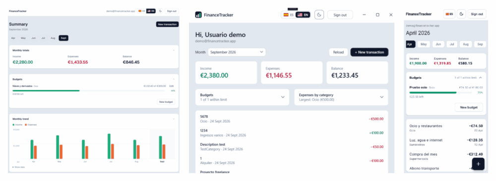
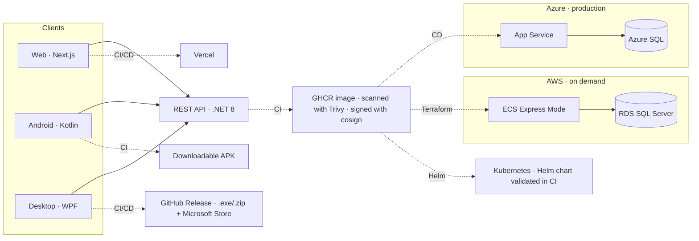

<b>🇬🇧 English</b> · 🇪🇸 Versión en español más abajo

### Hi, I'm Antonio Company 👋

**DevOps · DevSecOps | Azure · CI/CD · Kubernetes · Terraform | .NET**

.NET developer with DevOps and DevSecOps experience. At work I own the CI/CD of several applications (Azure DevOps Pipelines and GitHub Actions), migrated repositories from TFS 2018 to Git and organise the work in Azure Boards. In my own projects I apply Docker, Terraform on Azure and AWS, Kubernetes and security inside the pipeline (SAST, SCA, secrets, containers, IaC and DAST): I want security to speed delivery up, not slow it down. I come from .NET development, so I understand the code I deploy, not just the pipeline.

 

## ⚙️ CI/CD & DevOps
- Git / GitHub — version control; migrated repos from TFS 2018 to Git
- GitHub Actions — CI/CD on Linux and Windows runners
- Azure DevOps — Repos (mirrored from GitHub), Boards, Pipelines and Wiki
- Jenkins — declarative Jenkinsfile, Linux agent on Docker Compose, JUnit
- Versioned Releases and automated artifacts
- Pipeline-gated deployments: shipped only when every check passes
- 🔒 DevSecOps — gitleaks, CodeQL, Trivy, OWASP ZAP, cosign + Syft and least privilege with OIDC ([details](#-security-across-my-repositories-devsecops))

## ☁️ Cloud & Infrastructure
- Docker and GHCR — images tagged by commit
- Terraform — Azure and AWS, remote state and a `plan` on every PR
- Azure — App Service, Azure SQL and Key Vault with managed identity
- AWS — ECS Express Mode + RDS, brought up on demand (multicloud)
- Kubernetes and Helm — my own chart, validated in CI
- Observability — Application Insights (OpenTelemetry) and Azure Monitor alerts

## 💻 Development
- C# / VB.NET · .NET Framework / .NET 8
- Entity Framework / EF Core / Windows Forms
- SQL Server
- HTML, CSS, JavaScript / TypeScript · Node.js, React, Tailwind CSS
- Java/Kotlin (Android Studio)
- AI-assisted development — Claude Code every day, guided by my own kit of rules and skills ([ai-project-kit](#other-projects)): tests first, and the AI never commits

## 🚀 Featured projects

### FinanceTracker — one API, three clients

**⚡ Try it in one minute**

| 🌐 Web | 📱 Android | 🪟 Windows | 🔌 API |
|:---:|:---:|:---:|:---:|
| [Open the demo](https://financetracker-web-tau.vercel.app/login) | [Download APK](https://github.com/antonicr1986/financetracker-android/releases/latest/download/financetracker.apk) | [Microsoft Store](https://apps.microsoft.com/detail/9NT27R8DZ2DQ?hl=en-us) | [Swagger](https://financetracker-api-cpctbta0gddddge5.belgiumcentral-01.azurewebsites.net/swagger) |
| In the browser, nothing to install | Android 7.0 or later | Windows 10/11, one click | Documented endpoints |

Use the **demo account** button or `demo@financetracker.app` / `Demo1234!`. The database is serverless and pauses when idle: all three apps wake it as soon as the sign-in screen opens, so the wait happens while you read it.

A REST API and three clients on different platforms: the same endpoints, error codes and business rules reached from three languages, which is what turns the API into a contract. Shared look, light/dark theme, Spanish/English and one demo account.

- 🔗 [FinanceTracker](https://github.com/antonicr1986/FinanceTracker) — REST API in .NET 8 (JWT, sign-in with Google) used by all three clients.
  - **CI/CD**: Docker image per commit in GHCR, signed with cosign + SBOM, deployed to Azure App Service without rebuilding
  - **Security**: deploys only if tests, secrets, Trivy and OWASP ZAP pass; secrets in Key Vault via managed identity
  - **IaC and multicloud**: Terraform on Azure and AWS (ECS + RDS on demand), `plan` on every PR via OIDC
  - **Kubernetes and observability**: Helm chart validated in CI · Application Insights with alerts

  **[Browse the API in Swagger](https://financetracker-api-cpctbta0gddddge5.belgiumcentral-01.azurewebsites.net/swagger)**

- 🔗 [financetracker-web](https://github.com/antonicr1986/financetracker-web) — Web client in Next.js 16, TypeScript and Tailwind CSS.
  - Sign-in with Google, filters, dashboard with charts, light/dark and Spanish/English
  - Deployed to Vercel by the pipeline itself, only with the secret scan and build green
  - OWASP ZAP scans the live site after every deployment

  **[Open the live app](https://financetracker-web-tau.vercel.app/login)**

- 🔗 [financetracker-android](https://github.com/antonicr1986/financetracker-android) — Android client in Kotlin.
  - Sign-in with Google (Credential Manager), transactions, budgets and the same look as the web app
  - CI with secret scanning, MobSF and unit tests that fail if none ran
  - Downloadable APK on every run and a signed Release on every tag

  **[Download the latest APK](https://github.com/antonicr1986/financetracker-android/releases/latest/download/financetracker.apk)** · Android 7.0+

- 🔗 [financetracker-desktop](https://github.com/antonicr1986/financetracker-desktop) — Windows client in WPF and .NET 8 with MVVM.
  - Sign-in with Google, session encrypted with DPAPI and 150+ tests with no UI or network
  - Windows runner: self-contained Release (`.zip` / `.exe`) on every tag
  - MSIX package published on the Microsoft Store

  **[Available on the Microsoft Store](https://apps.microsoft.com/detail/9NT27R8DZ2DQ?hl=en-us)**

### Other projects

- 🧰 **ai-project-kit** *(private repo · [download it from my CV](https://antonio-cv-five.vercel.app/?lang=en))* — Kit to develop any project safely with AI assistants.
  - Rules for the AI (`CLAUDE.md`, `AGENTS.md`) and skills `/backlog` → `/story` → `/pair` → `/code-review`: tests first, the AI never commits
  - CI templates for GitHub Actions and Azure DevOps with Gitleaks and least privilege
  - PowerShell installer, automatic releases, 8 ADRs and 113 Pester tests

- 📄 **antonio-cv** *(private repo · [open it](https://antonio-cv-five.vercel.app/?lang=en))* — My interactive CV in Next.js 16 and React 19: bilingual, light/dark and printable to PDF.
  - AI chat (OpenAI) hardened like a public API: rate limits and same-origin requests only
  - Deploys to Vercel only with gitleaks, lint, `npm audit`, tests and build green; then smoke test and OWASP ZAP

- 🔧 **Jenkins CI for .NET** *(private repos)* — Jenkins on Docker Compose, set up the way a company would.
  - Controller with 0 executors and a Linux agent with the .NET 10 SDK
  - Declarative Jenkinsfile: build, JUnit tests and artifacts; if tests fail, nothing is published
  - Its own CI with Gitleaks, Hadolint and Trivy: 20 high vulnerabilities found and fixed

- 🔗 [BlocDeNotas](https://github.com/antonicr1986/BlocDeNotas) — Windows Forms app (.NET Framework 4.7.2): Windows runner with MSBuild and NuGet, and a Release with changelog and versioned binary on every tag.

> **Four delivery models, each where it fits:** container image (API), gated website (web), versioned executable (desktop) and APK (Android).

## 🔒 Security across my repositories (DevSecOps)

Live figures from my [security-dashboard](https://github.com/antonicr1986/security-dashboard): a weekly GitHub Actions job reads the alerts and workflows of every repo and applies a quality gate. Click the card for the full report.

> **Detecting and preventing are different layers, and both are needed.**

| Layer | Tool | When it acts |
|---|---|---|
| 🛑 Prevent secret leaks | **gitleaks** in a `pre-commit` hook | Before the commit exists |
| 🔍 Detect secret leaks | **gitleaks** in CI · GitHub *push protection* | On every push, in all my public repos |
| 🧠 Static code analysis (SAST) | **CodeQL** | On every push and pull request |
| 📦 Vulnerable dependencies | `dotnet list package --vulnerable` · `npm audit` · dependency graph + *dependency review* | On every pipeline and pull request |
| 🐳 Docker image | **Trivy** | Before pushing to GHCR |
| ✍️ Image signing and SBOM | **cosign** (keyless) · **Syft** (SPDX) | When pushing to GHCR, verifiable with `cosign verify` |
| 📱 Android APK | **MobSF** | On every push and pull request (blocks on new high findings) |
| 🏗️ Infrastructure as code | **Trivy** (`trivy config`) | Before deploying |
| 🌐 Running application (DAST) | **OWASP ZAP**: active and authenticated in a throwaway environment · passive in production | Before deploying the API (blocks) and after every deployment |
| 🗝️ Production secrets | **Azure Key Vault** · managed identity · **AWS SSM** (write-only) | Always: the API reads them at startup |
| 👤 Cloud access | **AWS IAM Identity Center** (SSO) · MFA | When running Terraform: 1-hour credentials, no long-lived access keys |
| 🔐 Least privilege | read-only `GITHUB_TOKEN` · **OIDC** | In every workflow |
| 🌿 Main branch protection | GitHub **rulesets** | On the main branch of my public repos |
| 📬 Vulnerability reporting | `SECURITY.md` · *private vulnerability reporting* | In my public repos |
| 🔄 Staying up to date | **Dependabot** | One pull request a month |

<b>How I apply it: secrets, dependencies and from pipeline to production</b>

### 🔑 Secrets

- **Custom rules.** They extend gitleaks' defaults, which catch keys from well-known providers but not a password inside a connection string — the shape a leak takes in a .NET project.
- **Audited history.** It surfaced real credentials from 2023 and 2024. They are revoked, and each is recorded in `.gitleaksignore` with what it was and what was done, because a pipeline that stays red stops being read.
- **CI detects, the hook prevents.** By the time the workflow fails, the commit is already published; the local `pre-commit` hook blocks it before it exists.
- **Verified tools.** In the API's pipeline, gitleaks is installed at a pinned version and its SHA-256 is checked before it runs.
- **No secrets from the first commit.** The Telegram bot never had its token in the code: it reads it from an environment variable.

### 📦 Dependencies

- **Each ecosystem with its own tool**, transitive dependencies included: .NET and npm with theirs; on Android, since Gradle has no equivalent, the CI submits the dependency graph to GitHub and a review blocks pull requests that introduce a vulnerable one.
- **Trivy on the API image.** It also covers the base OS libraries, which no .NET tool sees. With a high or critical vulnerability that has a fix, the image is not published.
- **Dependabot, without the noise.** A single monthly pull request with minor and patch updates, for packages and workflow actions. Major versions are ignored on purpose: they can break the code, and that deserves a decision, not one more PR.

### 🚦 From pipeline to production

- **Nothing reaches production without passing every check.** The API deployment waits for the tests, the secret scan, the image scan and the infrastructure scan: if one fails, nothing is deployed.
- **The infrastructure is scanned too.** Trivy reviews the Terraform before every deployment and blocks high or critical findings. Exceptions are deliberate decisions (for instance, what the free tier does not allow) and are documented with their reason in `.trivyignore`.
- **DAST that blocks.** Before deploying, the pipeline starts a throwaway API and SQL Server, signs in and OWASP ZAP attacks every endpoint from the Swagger spec: if it finds anything new, nothing is deployed. Afterwards, ZAP passively reviews the published API and web app. Accepted risks are documented with their reason in `.zap/rules.tsv`, and reports are kept as artifacts rather than issues, because the repos are public.
- **Security headers** on the API and the web app (CSP, HSTS, anti-clickjacking, `nosniff`...), added from the ZAP reports.
- **Watching production.** Application Insights collects the API's requests, errors and logs, and Azure Monitor sends an email on 5xx errors or 401/403 spikes, the footprint of a brute-force attack. All defined in Terraform.
- **Rotatable credentials.** The SQL admin password is a Terraform *write-only* argument: rotating it means bumping a version number, and it never reaches the state. On AWS, the RDS password and the JWT key work the same way, and the ECS role can read only those two parameters.
- **Least privilege.** The `GITHUB_TOKEN` is read-only by default and each job asks only for what it needs. Azure is reached via OIDC, with no passwords stored in GitHub, and the API has its own managed identity, whose only permission is reading secrets from its Key Vault. On AWS I sign in through IAM Identity Center with MFA: 1-hour credentials and no access keys stored on any machine.
- **Signed image with its SBOM.** After publishing, Syft generates the image's SBOM and cosign signs the image and attaches the SBOM as a signed attestation. Signing is *keyless*, with the workflow's OIDC identity: there is no key to store or leak, and `cosign verify` proves the image was built by my pipeline on `master`.
- **Protected main branch and a private channel for flaws.** Rulesets on the main branch of my public repos, and a `SECURITY.md` with private vulnerability reporting enabled, so a flaw can be reported without making it public.
- **Bounded pipelines.** Only one production deployment at a time (`concurrency`) and a time limit per job, so a stuck one does not burn minutes for hours.

---

- 🔭 At work: .NET developer and owner of the CI/CD of several applications (Azure DevOps and GitHub Actions); I also manage their SQL Server database and Azure services, built a generative AI chatbot with RAG, and do some Android and web work.
- 🎓 Latest course: [Claude Code in Action](https://verify.skilljar.com/c/fmhryo5fni98) (Anthropic, Aug 2026).
- 🌱 Currently learning: GitOps with Argo CD and Jenkins Configuration as Code, applying them in personal projects.
- 🤔 Interested in going deeper into: application architecture, AI tooling, testing and best practices.
- 📫 Contact: [LinkedIn](https://www.linkedin.com/in/antoniocompany/?locale=en-US "Go to my profile") · [Interactive CV](https://antonio-cv-five.vercel.app/?lang=en "See my interactive CV").
- ⚡ Outside of code: I follow tech news and enjoy sport.

<b>🇪🇸 Español</b>

### Hola, soy Antonio Company 👋

**DevOps · DevSecOps | Azure · CI/CD · Kubernetes · Terraform | .NET**

Desarrollador .NET con experiencia en DevOps y DevSecOps. En el trabajo llevo el CI/CD de varias aplicaciones (Azure DevOps Pipelines y GitHub Actions), he migrado repositorios de TFS 2018 a Git y organizo el trabajo en Azure Boards. En mis proyectos aplico Docker, Terraform en Azure y AWS, Kubernetes y seguridad dentro del pipeline (SAST, SCA, secretos, contenedores, IaC y DAST): busco que la seguridad acelere la entrega, no que la frene. Vengo del desarrollo .NET, así que entiendo el código que despliego y no solo el pipeline.

 

## ⚙️ CI/CD y DevOps
- Git / GitHub — control de versiones; migración de repos de TFS 2018 a Git
- GitHub Actions — CI/CD sobre runners Linux y Windows
- Azure DevOps — Repos (espejo desde GitHub), Boards, Pipelines y Wiki
- Jenkins — Jenkinsfile declarativo, agente Linux en Docker Compose, JUnit
- Releases versionadas y artefactos automáticos
- Despliegues controlados por el pipeline: solo si pasan todos los controles
- 🔒 DevSecOps — gitleaks, CodeQL, Trivy, OWASP ZAP, cosign + Syft y mínimo privilegio con OIDC ([ver detalle](#-seguridad-en-mis-repositorios-devsecops))

## ☁️ Cloud e Infraestructura
- Docker y GHCR — imágenes etiquetadas por commit
- Terraform — Azure y AWS, estado remoto y `plan` en cada PR
- Azure — App Service, Azure SQL y Key Vault con identidad administrada
- AWS — ECS Express Mode + RDS, levantado bajo demanda (multicloud)
- Kubernetes y Helm — chart propio validado en CI
- Observabilidad — Application Insights (OpenTelemetry) y alertas en Azure Monitor

## 💻 Desarrollo
- C# / VB.NET · .NET Framework / .NET 8
- Entity Framework / EF Core / Windows Forms
- SQL Server
- HTML, CSS, JavaScript / TypeScript · Node.js, React, Tailwind CSS
- Java/Kotlin (desarrollo con Android Studio)
- Desarrollo asistido por IA — Claude Code a diario, guiado por mi propio kit de reglas y skills ([ai-project-kit](#otros-proyectos)): tests primero, y la IA nunca hace commit

## 🚀 Proyectos destacados

### FinanceTracker — una API y tres clientes

**⚡ Pruébalo en 1 minuto**

| 🌐 Web | 📱 Android | 🪟 Windows | 🔌 API |
|:---:|:---:|:---:|:---:|
| [Abrir la demo](https://financetracker-web-tau.vercel.app/login) | [Descargar APK](https://github.com/antonicr1986/financetracker-android/releases/latest/download/financetracker.apk) | [Microsoft Store](https://apps.microsoft.com/detail/9NT27R8DZ2DQ?hl=es-es) | [Swagger](https://financetracker-api-cpctbta0gddddge5.belgiumcentral-01.azurewebsites.net/swagger) |
| En el navegador, sin instalar nada | Android 7.0 o superior | Windows 10/11, un clic | Endpoints documentados |

Entra con el botón de la **cuenta de demostración** o con `demo@financetracker.app` / `Demo1234!`. La base de datos es serverless y se pausa cuando no se usa: las tres apps la despiertan en cuanto se abre el login, así que la espera ocurre mientras lo lees.

Una API REST y tres clientes en plataformas distintas: los mismos endpoints, códigos de error y reglas de negocio desde tres lenguajes, que es lo que convierte la API en un contrato. Estética común, tema claro/oscuro, español/inglés y una cuenta de demostración.

- 🔗 [FinanceTracker](https://github.com/antonicr1986/FinanceTracker) — API REST en .NET 8 (JWT, inicio de sesión con Google) que consumen los tres clientes.
  - **CI/CD**: imagen Docker por commit en GHCR, firmada con cosign + SBOM, desplegada en Azure App Service sin recompilar
  - **Seguridad**: solo despliega si pasan tests, secretos, Trivy y OWASP ZAP; secretos en Key Vault con identidad administrada
  - **IaC y multicloud**: Terraform en Azure y AWS (ECS + RDS bajo demanda), `plan` en cada PR con OIDC
  - **Kubernetes y observabilidad**: chart de Helm validado en CI · Application Insights con alertas

  **[Ver la API en Swagger](https://financetracker-api-cpctbta0gddddge5.belgiumcentral-01.azurewebsites.net/swagger)**

- 🔗 [financetracker-web](https://github.com/antonicr1986/financetracker-web) — Cliente web en Next.js 16, TypeScript y Tailwind CSS.
  - Inicio de sesión con Google, filtros, dashboard con gráficos, tema claro/oscuro y español/inglés
  - Lo despliega en Vercel el propio pipeline, solo con el escaneo de secretos y el build en verde
  - OWASP ZAP analiza la web publicada tras cada despliegue

  **[Abrir la aplicación](https://financetracker-web-tau.vercel.app/login)**

- 🔗 [financetracker-android](https://github.com/antonicr1986/financetracker-android) — Cliente Android en Kotlin.
  - Inicio de sesión con Google (Credential Manager), movimientos, presupuestos y la misma estética que la web
  - CI con escaneo de secretos, MobSF y pruebas unitarias que fallan si no se ejecuta ninguna
  - APK descargable en cada ejecución y Release firmada en cada versión

  **[Descargar el último APK](https://github.com/antonicr1986/financetracker-android/releases/latest/download/financetracker.apk)** · Android 7.0+

- 🔗 [financetracker-desktop](https://github.com/antonicr1986/financetracker-desktop) — Cliente de Windows en WPF y .NET 8 con MVVM.
  - Inicio de sesión con Google, sesión cifrada con DPAPI y más de 150 pruebas sin ventanas ni red
  - Runner de Windows: Release autocontenida (`.zip` / `.exe`) en cada versión
  - Paquete MSIX publicado en la Microsoft Store

  **[Disponible en Microsoft Store](https://apps.microsoft.com/detail/9NT27R8DZ2DQ?hl=es-es)**

### Otros proyectos

- 🧰 **ai-project-kit** *(repo privado · [descárgalo desde mi CV](https://antonio-cv-five.vercel.app/?lang=es))* — Kit para desarrollar cualquier proyecto con asistentes de IA de forma segura.
  - Reglas para la IA (`CLAUDE.md`, `AGENTS.md`) y skills `/backlog` → `/story` → `/pair` → `/code-review`: tests primero y la IA nunca hace commit
  - Plantillas de CI para GitHub Actions y Azure DevOps con Gitleaks y permisos mínimos
  - Instalador en PowerShell, releases automáticas, 8 ADR y 113 pruebas con Pester

- 📄 **antonio-cv** *(repo privado · [ábrelo](https://antonio-cv-five.vercel.app/?lang=es))* — Mi CV interactivo en Next.js 16 y React 19: bilingüe, claro/oscuro e imprimible en PDF.
  - Chat con IA (OpenAI) protegido como una API pública: límites de uso y solo peticiones del mismo origen
  - Solo despliega en Vercel con gitleaks, lint, `npm audit`, tests y build en verde; después, smoke test y OWASP ZAP

- 🔧 **Jenkins CI para .NET** *(repos privados)* — Jenkins en Docker Compose, montado como en una empresa.
  - Controller con 0 ejecutores y un agente Linux con el SDK de .NET 10
  - Jenkinsfile declarativo: build, tests JUnit y artefactos; si fallan tests, no se publica nada
  - CI propio con Gitleaks, Hadolint y Trivy: 20 vulnerabilidades altas encontradas y resueltas

- 🔗 [BlocDeNotas](https://github.com/antonicr1986/BlocDeNotas) — App de Windows Forms (.NET Framework 4.7.2): runner de Windows con MSBuild y NuGet, y Release con changelog y binario versionado en cada etiqueta.

> **Cuatro modelos de entrega, cada uno donde encaja:** imagen de contenedor (API), web con despliegue controlado (web), ejecutable versionado (escritorio) y APK (Android).

## 🔒 Seguridad en mis repositorios (DevSecOps)

Cifras reales de mi [security-dashboard](https://github.com/antonicr1986/security-dashboard): un job semanal de GitHub Actions lee las alertas y los workflows de cada repo y aplica un quality gate. Pulsa la tarjeta para ver el informe completo.

> **Detectar y prevenir son capas distintas, y hacen falta las dos.**

| Capa | Herramienta | Cuándo actúa |
|---|---|---|
| 🛑 Prevenir fugas de secretos | **gitleaks** en un hook `pre-commit` | Antes de que el commit exista |
| 🔍 Detectar fugas de secretos | **gitleaks** en CI · *push protection* de GitHub | En cada push, en todos mis repos públicos |
| 🧠 Análisis estático del código (SAST) | **CodeQL** | En cada push y pull request |
| 📦 Dependencias vulnerables | `dotnet list package --vulnerable` · `npm audit` · grafo de dependencias + *dependency review* | En cada pipeline y pull request |
| 🐳 Imagen Docker | **Trivy** | Antes de publicar en GHCR |
| ✍️ Firma y SBOM de la imagen | **cosign** (keyless) · **Syft** (SPDX) | Al publicar en GHCR, verificables con `cosign verify` |
| 📱 APK de Android | **MobSF** | En cada push y pull request (bloquea con hallazgos altos nuevos) |
| 🏗️ Infraestructura como código | **Trivy** (`trivy config`) | Antes de desplegar |
| 🌐 Aplicación en marcha (DAST) | **OWASP ZAP**: activo y autenticado en un entorno desechable · pasivo en producción | Antes de desplegar la API (bloquea) y después de cada despliegue |
| 🗝️ Secretos en producción | **Azure Key Vault** · identidad administrada · **AWS SSM** (write-only) | Siempre: la API los lee al arrancar |
| 👤 Acceso a la nube | **AWS IAM Identity Center** (SSO) · MFA | Al lanzar Terraform: credenciales de 1 hora, sin claves de acceso fijas |
| 🔐 Mínimo privilegio | `GITHUB_TOKEN` de solo lectura · **OIDC** | En todos los workflows |
| 🌿 Protección de la rama principal | **Rulesets** de GitHub | En la rama principal de mis repos públicos |
| 📬 Reporte de vulnerabilidades | `SECURITY.md` · *private vulnerability reporting* | En mis repos públicos |
| 🔄 Mantenerse al día | **Dependabot** | Una pull request al mes |

<b>Cómo lo aplico: secretos, dependencias y del pipeline a producción</b>

### 🔑 Secretos

- **Reglas propias.** Extienden las de gitleaks: las de serie detectan claves de proveedores conocidos, pero no una contraseña dentro de una cadena de conexión, que es la forma que toma una fuga en un proyecto .NET.
- **Historial auditado.** Aparecieron credenciales reales de 2023 y 2024. Están revocadas y cada una queda registrada en `.gitleaksignore` con qué era y qué se hizo, porque un pipeline siempre en rojo deja de leerse.
- **El CI detecta, el hook previene.** Cuando el workflow falla, el commit ya está publicado; el `pre-commit` local lo bloquea antes de que llegue a existir.
- **Herramientas verificadas.** En el pipeline de la API, gitleaks se instala con una versión fijada y se comprueba su SHA-256 antes de ejecutarlo.
- **Sin secretos desde el primer commit.** El bot de Telegram nunca tuvo el token en el código: lo lee de una variable de entorno.

### 📦 Dependencias

- **Cada ecosistema con su herramienta**, también para dependencias transitivas: .NET y npm con las suyas; en Android, como Gradle no trae un equivalente, el CI envía el grafo de dependencias a GitHub y una revisión bloquea las pull requests que introducen una vulnerable.
- **Trivy en la imagen de la API.** Revisa también las librerías del sistema operativo base, que ninguna herramienta de .NET ve. Con una vulnerabilidad alta o crítica que tenga parche, la imagen no se publica.
- **Dependabot, sin ruido.** Una única pull request mensual con las actualizaciones menores y de parche, de paquetes y de acciones. Las versiones mayores se ignoran a propósito: pueden romper el código, y eso merece una decisión, no una PR más.

### 🚦 Del pipeline a producción

- **Nada llega a producción sin pasar todos los controles.** El despliegue de la API espera a los tests, al escaneo de secretos, al de la imagen y al de la infraestructura: si uno falla, no se despliega.
- **La infraestructura también se escanea.** Trivy revisa el Terraform antes de cada despliegue y bloquea los hallazgos altos o críticos. Las excepciones son decisiones conscientes (por ejemplo, lo que el plan gratuito no permite) y quedan documentadas con su motivo en `.trivyignore`.
- **DAST que bloquea.** Antes de desplegar, el pipeline levanta la API y un SQL Server desechables, inicia sesión y OWASP ZAP ataca todos los endpoints a partir del Swagger: si encuentra algo nuevo, no se despliega. Después, ZAP revisa de forma pasiva la API y la web ya publicadas. Los riesgos aceptados están documentados con su motivo en `.zap/rules.tsv`, y los informes quedan como artefactos y no como issues, porque los repos son públicos.
- **Cabeceras de seguridad** en la API y la web (CSP, HSTS, anti-clickjacking, `nosniff`...), añadidas a partir de los informes de ZAP.
- **Vigilancia en producción.** Application Insights recoge peticiones, errores y logs de la API, y Azure Monitor avisa por email ante errores 5xx o picos de 401/403, la huella de un ataque de fuerza bruta. Todo definido en Terraform.
- **Credenciales que se rotan.** La contraseña del administrador SQL es un argumento *write-only* de Terraform: rotarla es subir un número de versión, sin que llegue nunca al estado. En AWS, la contraseña de RDS y la clave JWT funcionan igual, y el rol de ECS solo puede leer esos dos parámetros.
- **Mínimo privilegio.** El `GITHUB_TOKEN` es de solo lectura por defecto y cada job pide solo lo que necesita. Azure se alcanza por OIDC, sin contraseñas guardadas en GitHub, y la API tiene su propia identidad administrada, cuyo único permiso es leer los secretos de su Key Vault. En AWS entro por IAM Identity Center con MFA: credenciales de 1 hora y ninguna clave de acceso guardada en ningún equipo.
- **Imagen firmada y con su SBOM.** Tras publicarla, Syft genera el SBOM de la imagen y cosign firma la imagen y le adjunta el SBOM como attestation firmada. La firma es *keyless*, con la identidad OIDC del workflow: no hay clave que guardar ni que se pueda filtrar, y `cosign verify` demuestra que la imagen la construyó mi pipeline en `master`.
- **Rama principal protegida y un canal privado para fallos.** Rulesets en la rama principal de mis repos públicos y un `SECURITY.md` con el reporte privado de vulnerabilidades activado, para que un fallo se pueda avisar sin hacerlo público.
- **Pipelines acotados.** Un solo despliegue a producción a la vez (`concurrency`) y un tiempo máximo por job, para que uno colgado no consuma minutos durante horas.

---

- 🔭 En el trabajo: programador .NET y responsable del CI/CD de varias aplicaciones (Azure DevOps y GitHub Actions); también administro su base de datos SQL Server y sus servicios en Azure, he desarrollado un chatbot de IA generativa con RAG y hago algo de Android y web.
- 🎓 Último curso: [Claude Code in Action](https://verify.skilljar.com/c/fmhryo5fni98) (Anthropic, agosto de 2026).
- 🌱 Aprendiendo ahora mismo: GitOps con Argo CD y Jenkins Configuration as Code, aplicándolo en proyectos personales.
- 🤔 Me interesa profundizar en: arquitectura de aplicaciones, herramientas IA, testing y buenas prácticas.
- 📫 Contacto: [LinkedIn](https://www.linkedin.com/in/antoniocompany/?locale=es-ES "Ir a mi perfil") · [CV web](https://antonio-cv-five.vercel.app/?lang=es "Ver mi CV").
- ⚡ Fuera del código: sigo la actualidad tecnológica y me gusta hacer deporte.

